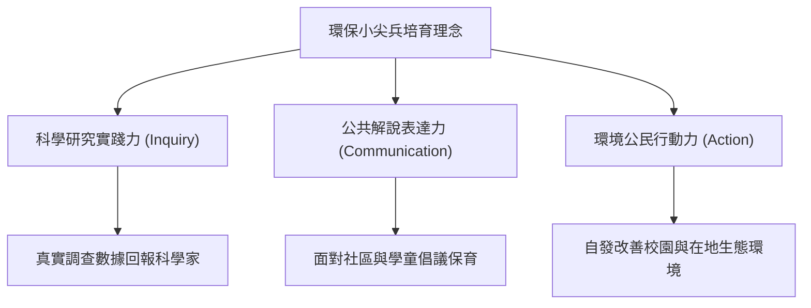

# 2018 全國學校經營與教學創新 KDP 國際認證獎：環保小尖兵培訓教學課程

## 原始文檔資訊
- **獲獎競賽**：2018 全國學校經營與教學創新 KDP 國際認證獎（Kappa Delta Pi International Honor Society in Education）
- **認證編號**：TG.003（高中組自然科學領域）
- **完整方案簡報**：`file:///Users/froglssh/Library/CloudStorage/GoogleDrive-frog@lssh.tp.edu.tw/我的雲端硬碟/09課程發表/1公民科學家/環保小尖兵培訓教學課程.pdf` (74 頁完整申報方案)
- **團隊成員**：林獻升、郭瓊華、蕭國偉、邱玉萱、林文琪（麗山高中跨科/生物科教師團隊）

---

## 一、方案核心精神與國際認證標準對齊

KDP 國際認證獎重視「目標導向、學生主體、學習成效評鑑與全球視野」。本方案以**「環保小尖兵——環境保護實際行動力」**為品牌核心，將高中生物教育跨界延伸至公共倡議與永續發展：

---

## 二、方案創新架構與五大實施成果 (74 頁方案精粹)

1. **五階段漸進式培訓**：
   - 階段一（認知）：基礎生態學與物種鑑定。
   - 階段二（技能）：儀器操作與樣區實測。
   - 階段三（轉譯）：解說技巧與生態遊戲自編。
   - 階段四（應用）：多日極限實察（東眼山、拉拉山、平湖、馬岡）。
   - 階段五（回饋）：服務學習出隊與社區導覽。
2. **跨領域資源整合**：
   - 整合麗山高中生物科、地科科與行政處室資源，建立「行政後勤 ➔ 教研共備 ➔ 田野實察 ➔ 成果公開」之四維營運機制。
3. **量化與質性成效全方位評鑑**：
   - 學生問卷滿意度高達 4.8 / 5.0。
   - 學生後續升學選擇生科、生資、環工學群比例顯著高於平均。

---

## 關聯與導航
- [[天下文化未來100得獎教案深度剖析]]
- [[臺北市第19屆行動研究雙特優成果紀實]]
- [[臺北市優質學校評選申辦論述指南]]
- 母庫參照：`file:///Users/froglssh/Library/CloudStorage/GoogleDrive-frog@lssh.tp.edu.tw/我的雲端硬碟/12生物營隊/生物營隊知識庫/concepts/行動研究經驗轉化與課綱銜接.md`
