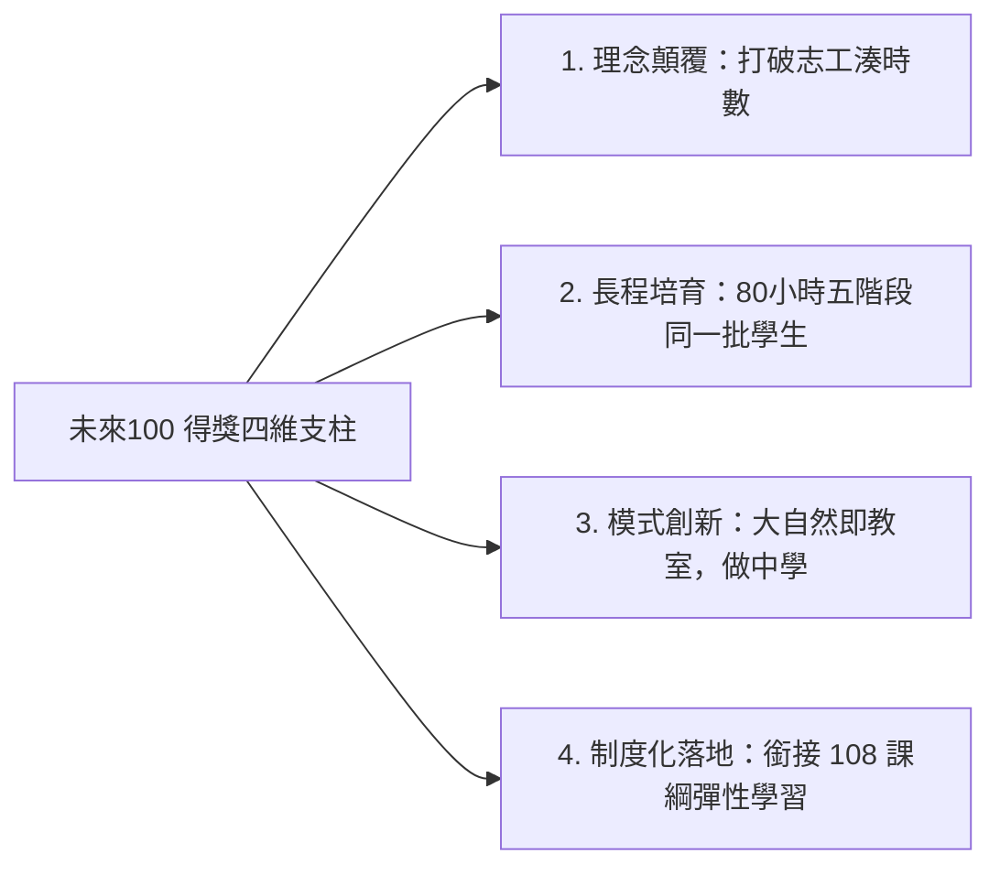

# 遠見・天下文化「未來教育 臺灣100」得獎教案深度剖析

## 原始文檔資訊
- **獲獎名稱**：遠見・天下文化基金會「未來教育 臺灣100 (Future Education Taiwan 100)」入選得獎教案
- **完整教案簡報**：`file:///Users/froglssh/Library/CloudStorage/GoogleDrive-frog@lssh.tp.edu.tw/我的雲端硬碟/09課程發表/1公民科學家/天下文化未來100得獎教案＿公民科學家培訓課程.pdf` (67 頁高畫質成果簡報)
- **教案全名**：公民科學家與保育解說員培訓課程——彈性學習・環境教育・服務學習
- **團隊成員**：林獻升、郭瓊華、蕭國偉（麗山高中生物科）

---

## 一、得獎核心優勢與評審青睞關鍵

「未來教育 臺灣100」評選著眼於「前瞻創新性、問題解決力、可複製推廣性、教育影響力」。本教案從全國數百所各級學校創新方案中脫穎而出，關鍵在於四大顛覆性突破：

1. **顛覆服務學習平庸化**：切中 12 年國教超額比序「志工時數」引發的「掃地排書」亂象，重新定義志工為「受過專業訓練的科研助理與生態守護者」。
2. **長程培育的執著**：不辦 1~2 天煙火式營隊，而是利用週末與課餘，對同一批學生進行長達 80 小時的系統化淬鍊。
3. **無可取代的五感田野體驗**：將課堂搬至金面山、平湖森林、馬岡海蝕平台、東眼山、拉拉山神木區，讓學生在真實生態系中激發土地情感。
4. **教材模組化與高推廣性**：發展「3 套實體講義 + 1 數位光碟」，讓全國中學生物老師皆可即插即用。

---

## 二、教案 67 頁完整架構全景梳理

依據原始 67 頁得獎簡報，全案嚴謹分為五大篇章：

### 壹. 課程設計緣由 (P.6)
- 法源出發：呼應我國《環境教育法》每人每年 4 小時環境教育之立法意旨。
- 痛點反思：傳統教室內講述式教學無法引發學生保護生態的真實行動力。

### 貳. 創新教學作法 (P.7 - P.12)
- **以自然環境為教室**：走出戶外，調動五感（眼看、耳聽、鼻聞、手摸、嘴嘗）。
- **教師社群 (PLC) 共創**：麗山 5 位生物教師定期開會備課，依專長（鳥類、昆蟲、解說、課程）分工協同。

### 參. 五階段長程培訓課程 (P.13 - P.59)
- **第一階段：生態保育知識教學（8小時，P.13-16）**：生物多樣性、標本辨識。
- **第二階段：生態調查技術教學（26小時，P.17-32）**：工具訓練（高枝剪、夜間燈誘）、校園金面山實察、平湖森林與馬岡潮間帶調查。
- **第三階段：生態解說知能教學（24小時，P.33-42）**：生態旅遊、海科館參訪、自編生態遊戲（如搶救棲地、草木皆兵）。
- **第四階段：生態知識與技術應用（3天2夜，P.43-55）**：東眼山、象山農場夜觀、路殺動物監測、北橫拉拉山神木區生態考察。
- **第五階段：教學成效評鑑活動（4小時，P.56-59）**：金面山實地導覽演練、生態遊戲成果評鑑、頒發結業認證。

### 肆. 課程遠景：環境保護實際行動力 (P.60 - P.64)
- 培育「公民科學調查志工」與「自然生態解說志工團」。
- 達成 108 課綱「自主行動、溝通互動、社會參與」核心素養。

### 伍. 課程推廣與新課綱銜接 (P.65 - P.67)
- 轉化為高中「彈性學習課程教材模組」，培訓學生成為臺灣生態保育的「環保小尖兵」。

---

## 關聯與導航
- [[2018全國KDP教學創新國際認證獎_環保小尖兵]]
- [[臺北市第19屆行動研究雙特優成果紀實]]
- [[108年新課綱彈性學習課程實施成果]]
- 母庫參照：`file:///Users/froglssh/Library/CloudStorage/GoogleDrive-frog@lssh.tp.edu.tw/我的雲端硬碟/12生物營隊/生物營隊知識庫/concepts/行動研究經驗轉化與課綱銜接.md`
- 課程庫參照：`file:///Users/froglssh/Library/CloudStorage/GoogleDrive-frog@lssh.tp.edu.tw/我的雲端硬碟/01專題教材/公民科學培訓課程/01_課程綱要與設計/高二多元選修_10週課程規劃表.md`
