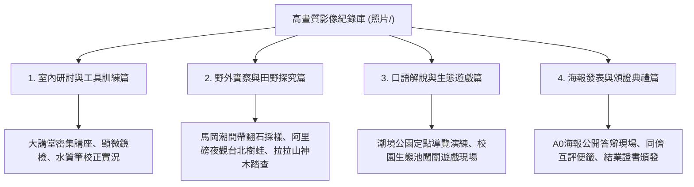

# 學生學習歷程照片與高畫質影像紀錄庫導航

本目錄收錄歷屆生物營隊與公民科學家培訓現場拍攝之高畫質活動影像（共 23 組重點場景照片），作為教師撰寫成果報告、製作簡報與申辦獎項之核心佐證素材庫。

---

## 原始影像目錄路徑
- **本機目錄**：`file:///Users/froglssh/Library/CloudStorage/GoogleDrive-frog@lssh.tp.edu.tw/我的雲端硬碟/09課程發表/1公民科學家/照片/`

---

## 關鍵實景影像分類索引

### 1. 課堂與工具訓練實景
- 記錄學生聚精會神操作 GPS 定位儀、高枝剪採集校園樹葉、顯微鏡觀察浮游生物。
- **適用場合**：教學創新方案之「研究方法訓練」篇章。

### 2. 野外實察震撼瞬間
- 捕捉學生穿著防滑鞋小心翼翼行走在馬岡海蝕平台、手捧紫海膽觀察管足吸附、夜間在手電筒光暈下記錄赤蛙的生動神情。
- **適用場合**：招生海報封面、優質學校評選之「情境學習」展版。

### 3. 解說實戰與海報答辯
- 記錄學生脫稿自信面對群眾解說、以及在階梯大講堂面對評審教師提問時從容答辯之專注英姿。
- **適用場合**：學習歷程檔案封面、成果發表會紀念冊。

---

## 關聯與導航
- [[高中優質化成果嘉年華巨幅海報剖析]]
- [[歷屆公民科學家招募與宣傳海報設計]]
- [[臺北市優質學校評選申辦論述指南]]
