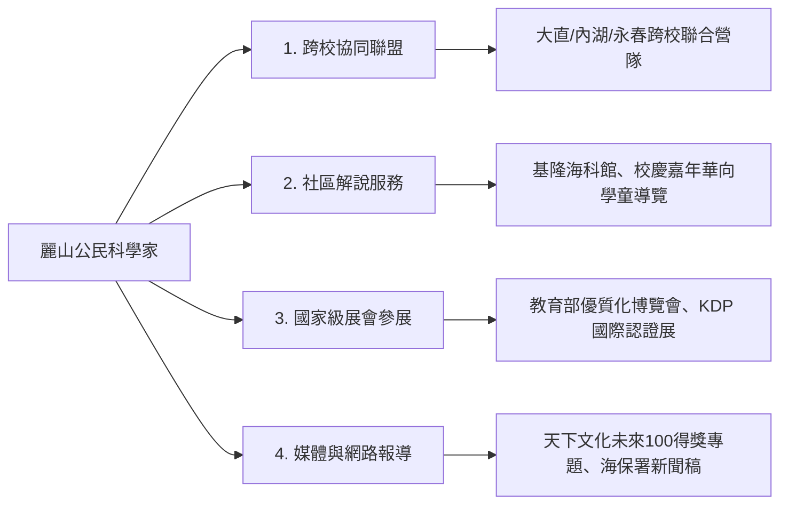

# 公民科學教育社會影響力、跨校推廣與公眾媒體溝通策略

## 一、從「校園圍牆內」走向「大眾視野」
優質的校本特色課程若只停留在單一學校內部，影響力終究有限。麗山高中公民科學家方案長年積極推動「成果發表會、跨校聯合營隊、社區解說嘉年華與公眾媒體報導」，建立廣大之教育社會資本。

---

## 二、四大公眾傳播與擴散渠道

1. **跨校協同與資源共享**：
   - 帶動臺北市多所公立高中建立跨校生態探究網絡，由麗山高中擔任領航火車頭。
2. **向下扎根服務學習**：
   - 與海保署「大手牽小手」計畫合作，由高中生牽著國小學童的手漫步潮間帶，形成跨世代的環境教育傳承。
3. **新聞稿與公眾傳播**：
   - 在重大得獎或營隊結束後，撰寫高質感的科學新聞稿，透過生動的學生第一手震撼心得，向大眾傳遞「高中生也能成為專業公民科學家」的正向能量。

---

## 關聯與導航
- [[臺北市優質學校評選申辦論述指南]]
- [[高中優質化成果嘉年華巨幅海報剖析]]
- [[天下文化未來100得獎教案深度剖析]]
