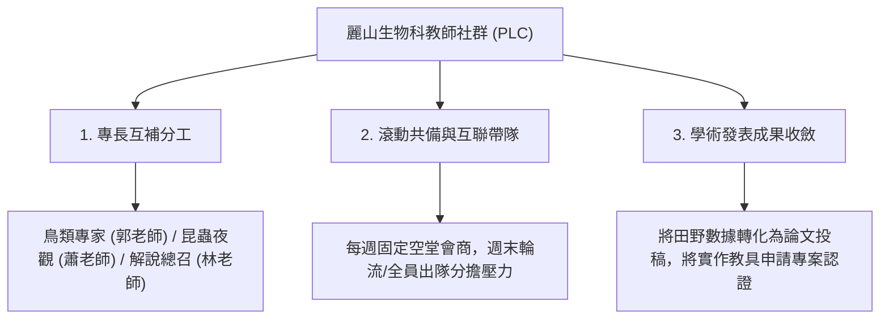

# 麗山高中生物科教師專業學習社群 (PLC) 協同備課與學術發表工作法

## 一、破除「單打獨鬥」，建立學習共同體
高中教師在升學與繁重課務下，往往難以承擔長期野外實察與跨學年行動研究之重負。麗山高中生物科之所以能連續奪得天下文化未來 100、KDP 國際認證與臺北市行動研究雙特優，核心關鍵在於**「制度化運作之教師專業學習社群 (PLC)」**。

---

## 二、社群三層協同作戰機制

1. **模組專長分工**：
   - 拒絕單一教師包辦全部主題。由鳥類專長負責候鳥辨識、昆蟲專長負責燈誘技術、地質與營隊專長負責潮間帶與行政申辦。
2. **田野安全集體把關**：
   - 野外考察時全員出動，建立領隊、安全官、攝影、救護之四重崗位，大幅降低戶外風險。
3. **教研一體化沉澱**：
   - 每次營隊或選修課結束，必定整理學生問卷與反思便籤，立即歸檔至知識庫，作為下一篇行動研究之厚實素材。

---

## 關聯與導航
- [[臺北市優質學校評選申辦論述指南]]
- [[公民科學社會影響力與媒體報導策略]]
- 母庫參照：`file:///Users/froglssh/Library/CloudStorage/GoogleDrive-frog@lssh.tp.edu.tw/我的雲端硬碟/12生物營隊/生物營隊知識庫/entities/人物_麗山生物科教師教學社群.md`
