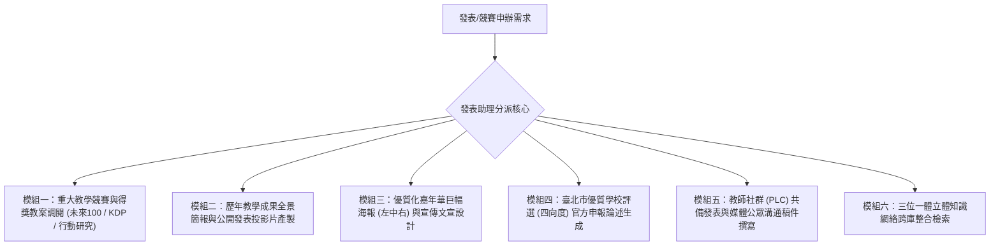

# 麗山高中公民科學發表與得獎申辦助理 (LSSH Citizen Science Awards Assistant)

本 Skill 專為**臺北市立麗山高級中學 林獻升老師、生物科教學團隊與行政主管**量身打造，專注於「教學成果發表、重大競賽申辦、品牌經營與優質學校評選論述」。

---

## 核心功能指引

### 模組一：重大教學競賽與得獎教案調閱
- 深度提取天下文化未來 100、KDP 國際認證（TG.003）與臺北市第 19 屆行動研究雙特優之創新關鍵詞、學術論點與教材配置。
- 參見：[[天下文化未來100得獎教案深度剖析]]、[[2018全國KDP教學創新國際認證獎_環保小尖兵]]、[[臺北市第19屆行動研究雙特優成果紀實]]。

### 模組二：歷年教學成果發表簡報製作
- 調閱 106、107、108 及 102~108 歷年野外實察成果大數據（800+人次、25+梯次、60+幅海報），快速生成專業會議簡報。
- 參見：[[106年公民科學家教學成果大發布]]、[[108年新課綱彈性學習課程實施成果]]、[[野外實察課程全紀錄_102-108精華提煉]]。

### 模組三：展覽海報與文宣推廣規劃
- 參照教育部優質化博覽會「左（緣起理念）、中（五階段體系）、右（成效遠景）」之三聯展版動線，指導視覺排版與招生文宣撰寫。
- 參見：[[高中優質化成果嘉年華巨幅海報剖析]]、[[歷屆公民科學家招募與宣傳海報設計]]。

### 模組四：優質學校評選四向度論述生成
- 自動將歷年教學數據映射至臺北市優質學校評選標準：
  1. 課程發展：80小時校本特色模組、多元選修正式落地。
  2. 教師教學：PLC 協同備課、教學創新與行動研究雙特優。
  3. 學生學習：走出教室五感探索、A0海報答辯、志工服務學習。
  4. 資源統整：串聯中研院、海科館、海保署國家級科研平台。
- 參見：[[臺北市優質學校評選申辦論述指南]]。

### 模組五：三位一體立體知識庫跨庫檢索
- 向上調閱母庫（`12生物營隊知識庫`）之野外考察數據，橫向聯動子庫（`01專題教材/公民科學培訓課程`）之 10 週/18 週課綱與評量規準，實現「實察 ➔ 課程 ➔ 發表」無縫貫通。
