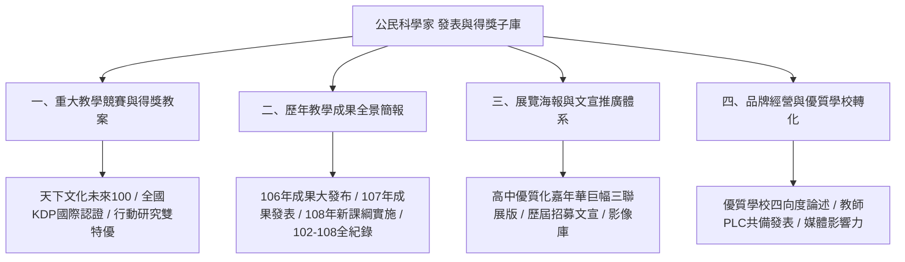

# 麗山高中公民科學家 課程發表與得獎子知識庫 全域主索引 (Dissemination & Awards Map)

歡迎查閱**臺北市立麗山高級中學 生物科**「公民科學家（課程發表、競賽得獎與推廣）」專屬子知識庫（Awards & Dissemination Sub-Wiki）。  
本知識庫沉澱麗山生物科歷年榮獲遠見・天下文化「未來教育 臺灣100」、全國教學創新 KDP 國際認證獎、臺北市行動研究雙特優等頂尖殊榮之教案精粹、巨幅展覽海報、成果發表簡報與優質學校申辦論述。

---

## 🌐 三位一體立體知識網絡通道 (Tri-Wiki Navigation)

```
┌────────────────────────────────────────────────────────────────────────┐
│                   麗山高中生物科 三位一體知識庫網絡                     │
├─────────────────────┬───────────────────┬──────────────────────────────┤
│ 🔗 母庫：田野實察大歷史 │ 🔗 子庫：校本選修開課  │ 📍 本庫：競賽得獎與品牌發表  │
│ [12生物營隊知識庫]   │ [01專題教材/選修課程]│ [09課程發表/1公民科學家]       │
└─────────────────────┴───────────────────┴──────────────────────────────┘
```

- 🔗 **[麗山生物營隊與公民科學家母知識庫 (Master Wiki)](file:///Users/froglssh/Library/CloudStorage/GoogleDrive-frog@lssh.tp.edu.tw/我的雲端硬碟/12生物營隊/生物營隊知識庫/index.md)**
- 🔗 **[公民科學培訓課程 課程子知識庫 (Curriculum Wiki)](file:///Users/froglssh/Library/CloudStorage/GoogleDrive-frog@lssh.tp.edu.tw/我的雲端硬碟/01專題教材/公民科學培訓課程/index.md)**

---

## 🧭 四大核心維度導航 (Core Dimensions)



---

### 一、重大教學競賽與得獎教案 (Awards & Innovations)
| 筆記名稱 | 競賽與獎項名稱 | 核心得獎創新亮點 |
| :--- | :--- | :--- |
| [[天下文化未來100得獎教案深度剖析]] | 遠見天下「未來教育 臺灣100」入選得獎 | 顛覆志工形式化、80小時五階段、大自然即教室、模組化教材 |
| [[2018全國KDP教學創新國際認證獎_環保小尖兵]] | 全國學校經營與教學創新 KDP 國際認證 (TG.003) | 環保小尖兵品牌理念、五階段漸進式培訓、跨學科整合教學方案 |
| [[臺北市第19屆行動研究雙特優成果紀實]] | 臺北市第 19 屆教育專業創新與行動研究 | 經驗分享類特優、教材教具實物展示類特優決審雙料登頂 |

---

### 二、歷年教學成果全景簡報 (Annual Outcome Decks)
| 筆記名稱 | 涵蓋學年度與檔案 | 核心內容與歷史定位 |
| :--- | :--- | :--- |
| [[106年公民科學家教學成果大發布]] | 106 學年度 (264MB PPTX / 134MB PDF) | 前瞻基礎建設面向一全額補助，四大模組試行成果全景影像 |
| [[107年公民科學家教學成果發表]] | 107 學年度 (87MB PPTX / 41MB PDF) | 模組化教材實體定型，榮獲行動研究雙特優後之推廣發表 |
| [[108年新課綱彈性學習課程實施成果]] | 108 學年度 (120MB PPTX / 42MB PDF) | 108 課綱元年正式落地為校訂選修，太平山三富、北海岸嘉年華 |
| [[野外實察課程全紀錄_102-108精華提煉]] | 102~108 學年度 (247MB PPTX / 124MB PDF) | 7 年橫跨 25+ 梯次、800+ 學生、60+ 幅海報之田野大數據總整 |

---

### 三、展覽海報與文宣推廣體系 (Exhibition Posters & PR)
| 筆記名稱 | 展覽場合與規格 | 核心設計與傳播功能 |
| :--- | :--- | :--- |
| [[高中優質化成果嘉年華巨幅海報剖析]] | 教育部全國優質化博覽會三聯展版 | 左（緣起理念）、中（五階段體系）、右（成效遠景）巨幅排版動線 |
| [[歷屆公民科學家招募與宣傳海報設計]] | 106、108 官方招生海報 | 四大黃金文案：破題痛點、田野探索、能力躍遷、升學加分 |
| [[學生學習歷程照片與影像紀錄庫]] | 田野、實驗室、海報公開答辯 | 23 組高畫質照片索引，提供簡報、文宣與審查佐證 |

---

### 四、品牌經營與優質學校轉化 (Branding & School Impact)
| 筆記名稱 | 應用情境與目標 | 核心論述工具 |
| :--- | :--- | :--- |
| [[臺北市優質學校評選申辦論述指南]] | 臺北市/教育部優質學校評選 | 課程發展、教師教學、學生學習、資源統整四大向度官方論述範本 |
| [[教師專業社群(PLC)協同發表工作法]] | 教師專業發展與論文發表 | 專長互補（鳥類/昆蟲/解說）、田野安全集體把關、教研一體化 |
| [[公民科學社會影響力與媒體報導策略]] | 公共傳播與跨校擴散 | 跨校協同聯盟、海保署大手牽小手、科學新聞稿撰寫準則 |

---

## ⚙️ 系統規範與工具 (Meta)
- 規範與 Schema 定義：[[wiki-rules]]
- 時間軸日誌：[[log]]
- 發表工作助理：[[SKILL]]
